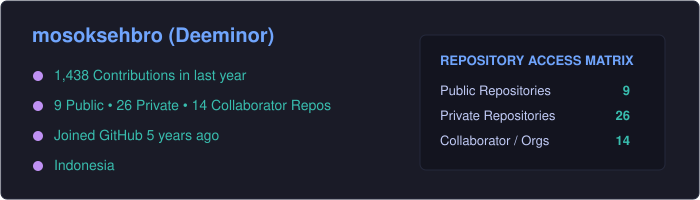
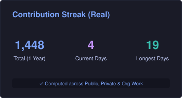
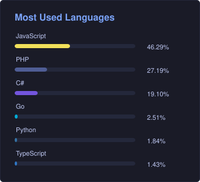
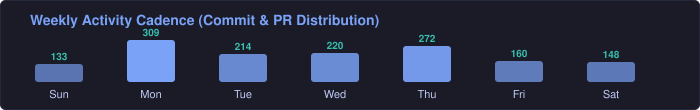

<div align="center">
  
  
  <p align="center">
    <strong>Crafting resilient backends, clean architectures, and scalable pipelines.</strong><br />
    Indonesia • <a href="https://gosade.my.id">gosade.my.id</a> • <a href="https://x.com/Deeminorr">@Deeminorr</a>
  </p>

  <p align="center">
    
  </p>
</div>

<br />

### Stack & Tooling

```bash
Backend      : Go, C#, PHP / Laravel, Node.js, Python
Frontend     : TypeScript, React, Next.js, React Native
Data & Infra : PostgreSQL, MySQL, Redis, Docker, Git, Linux
Core Focus   : Clean Architecture, High-throughput ETL, REST/gRPC APIs, Vision Models
```

<br />

### Engineering Principles & Focus

```text
• Architecture : Clean Architecture, Domain-Driven Design (DDD), Modular Services
• Reliability  : Idempotency, Graceful Degradation, Structured Telemetry & Logging
• Performance  : Query & Index Tuning, Connection Pooling, Cache Invalidation Strategies
• Current Work : High-throughput concurrent pipelines in Go & Edge CV inference
```

<br />

### Performance & Activity

<div align="center">
  
  
  <br /><br />

  <table border="0" cellspacing="0" cellpadding="0">
    <tr align="center">
      <td valign="top">
        
      </td>
      <td valign="top">
        
      </td>
    </tr>
  </table>

  <br />

  
</div>

<br />

### Collaboration & Contact

```yaml
Status       : Open for Backend Engineering, System Architecture & Consulting
Location     : Remote / Hybrid (GMT+7)
Website      : https://gosade.my.id
Twitter / X  : https://x.com/Deeminorr
```
