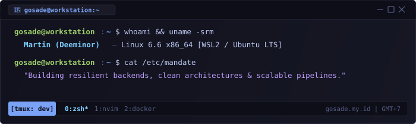

<div align="center">
  

  <p align="center">
    <a href="https://gosade.my.id"></a>
    <a href="https://x.com/Deeminorr"></a>
    
    
  </p>
</div>

<br />

### Stack & Tooling

```bash
Backend      : Go, C#, PHP / Laravel, Node.js, Python
Frontend     : TypeScript, React, Next.js, React Native
Data & Infra : PostgreSQL, MySQL, Redis, Docker, Git, Linux
Core Focus   : Clean Architecture, High-throughput ETL, REST/gRPC APIs, Vision Models
```

<br />

### Architecture & Engineering Blueprint

```text
  [ Clients / Endpoints ]
             │
             ▼
  ┌──────────────────────────────────────────────┐
  │         API Gateway & Reverse Proxy          │  ──▶ TLS Termination / Rate Limiting
  └──────────────────────┬───────────────────────┘
                         │
         ┌───────────────┴───────────────┐
         ▼                               ▼
  ┌──────────────┐                ┌──────────────┐
  │  Core API    │ (Sync/REST)    │ Worker Pool  │ (Async Batch / ETL)
  │  Go / C#     │                │ Python / PHP │
  └──────┬───────┘                └──────┬───────┘
         │                               │
         ├───────────────┬───────────────┤
         ▼               ▼               ▼
  ┌──────────────┐┌──────────────┐┌──────────────┐
  │ PostgreSQL   ││ Redis Cache  ││ Message Bus  │
  │ Primary DB   ││ Key-Value    ││ Event Stream │
  └──────────────┘└──────────────┘└──────────────┘
```

<br />

### Engineering Principles & Focus

```text
• Architecture : Clean Architecture, Domain-Driven Design (DDD), Modular Services
• Reliability  : Idempotency, Graceful Degradation, Structured Telemetry & Logging
• Performance  : Query & Index Tuning, Connection Pooling, Cache Invalidation Strategies
• Current Work : High-throughput concurrent pipelines in Go & Edge CV inference
```

<br />

### Performance & Activity

<div align="center">
  
  
  <br /><br />

  <table border="0" cellspacing="0" cellpadding="0">
    <tr align="center">
      <td valign="top">
        
      </td>
      <td valign="top">
        
      </td>
    </tr>
  </table>

  <br />

  
</div>

<br />

### Collaboration & Security Footprint

```yaml
Availability   : Open for High-Impact Backend Architecture, Distributed Systems & Consulting
Timezone       : Asia/Jakarta (WIB • GMT+7)
Direct Reach   : martinusade333@gmail.com • https://gosade.my.id
SSH PubKey     : SHA256:gE4b8eTfTKH74dIKeC7xieezZvKQ3JvbhO49OoaMnkk (RSA 4096)
Code Integrity : Signed commits & verified git workflows
```
